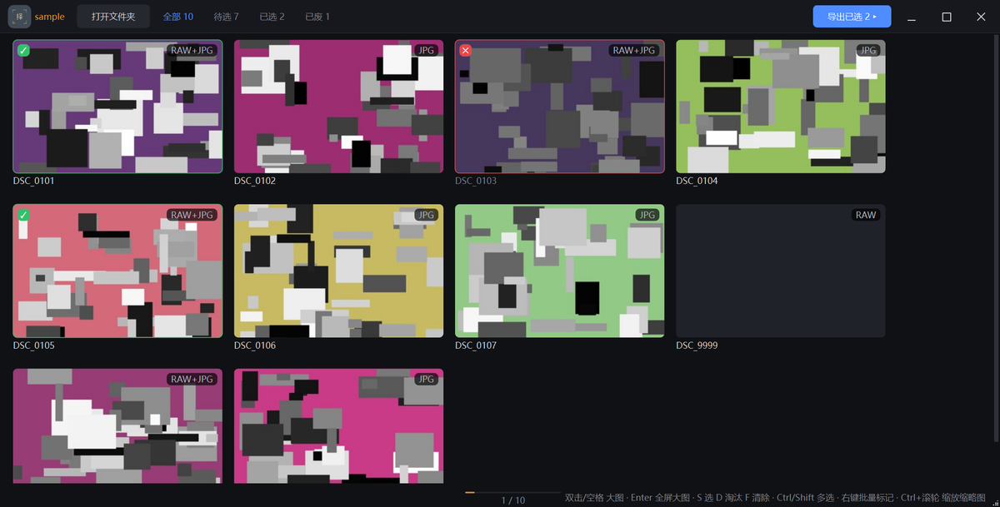
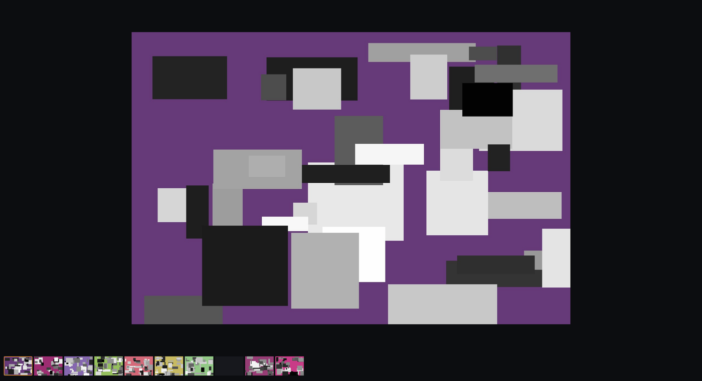
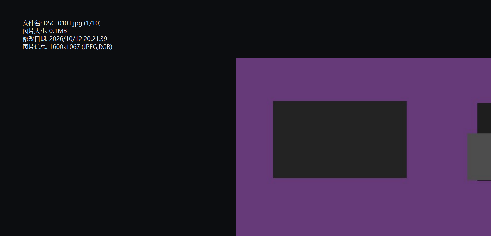

# 择影 · Photo Picker

摄影师选片工具：单文件 PySide6 桌面应用，深色界面、键盘驱动，同名 RAW+JPG 自动合并成一张显示。



选片结果写在照片文件夹里的 `.photopicker.json`（隐藏文件），跟着照片走，换电脑不丢。
缩略图缓存在 `%LOCALAPPDATA%\PhotoPicker\thumbs`，删掉会自动重建。

## 运行

**免安装（Windows x64）**：到 [Releases](https://github.com/xc1988/Photo-picker/releases) 下载 `PhotoPicker-vX.Y.Z-win-x64.zip`，解压后双击 `PhotoPicker/PhotoPicker.exe`，也可以把照片文件夹直接拖到图标上。

**源码**：

```
pip install -r requirements.txt
python photopicker.py [照片文件夹]      # 或双击 择影工具.bat
```

## 载入速度

缩略图只在需要时生成：视口内先出图，整夹再在后台慢慢铺进磁盘缓存，所以滚动到夹子末尾也不用排队等前面的任务；常驻内存的缩略图有上限，退出屏幕的退回磁盘缓存。

纯 RAW 夹子（如松下 RW2）的缩略图直接取相机内嵌的那张预览图，比完整后期快一个数量级——1200 张 RAW 首屏约 0.1 秒。代价是网格里的观感就是相机回看的观感：夜景会比后期渲染略暗，和 Lightroom 图库模块一致；双击进大图仍按 RAW 完整后期渲染，所以夜景从网格进大图会有轻微亮度跳变。JPG、以及 RAW+JPG 配对的夹子不受影响。

## 大图与 EXIF

大图模式没有工具栏，只有画面和底部一条胶片导航；点当前高亮那张即关闭。



按 `Tab` 在左上角浮出 EXIF 参数（文件名、大小、焦段、快门、光圈、ISO、测光…），翻页时保持打开。



## 快捷键

| 键 | 作用 |
| --- | --- |
| `双击` / `空格` | 打开大图（最大化）；在大图里再按即返回 |
| `Enter` | 直接全屏打开大图 |
| `Ctrl` / `Shift` + 点击 | 网格多选 |
| `S` `D` `F` | 已选 / 淘汰 / 清除（对全部选中项；同状态再按即清除） |
| `右键` | 菜单：选它 · 淘汰 · 清除 · 打开大图 · 打开所在文件夹 |
| `Ctrl` + 滚轮 | 缩放网格缩略图 |
| 拖文件夹进窗口 | 载入该文件夹 |
| `←` `→` / `A` | 大图翻页（首尾循环，末张标记后自动回到第一张） |
| 滚轮 / `0` `1` `2` | 大图以光标为锚缩放；适应窗口 / 原图 1:1 / 两倍 |
| 左键拖拽 | 缩放态平移 |
| `Tab` | EXIF 浮层开关 |
| `Esc` | 与 `双击` / `空格` 同效：全屏先退全屏，否则关闭大图回主界面 |

标记完点右上角 **导出已选**，把选中的照片连同配对 RAW 复制到新文件夹。

## 打包与发版

```
pip install pyinstaller
pyinstaller --noconfirm --clean PhotoPicker.spec     # 产物在 dist/PhotoPicker/
```

推 `v*` 标签即触发 GitHub Actions：Windows runner 用同一份 spec 打包，压缩成
`PhotoPicker-vX.Y.Z-win-x64.zip` 自动挂到 Release。

## 技术栈

PySide6（单文件约 1750 行）· Pillow + rawpy 解码 · `QSortFilterProxyModel` 做状态筛选 ·
无边框窗口 + 自绘窗控 + DWM 圆角 · 前后台双线程池按需生成缩略图。
